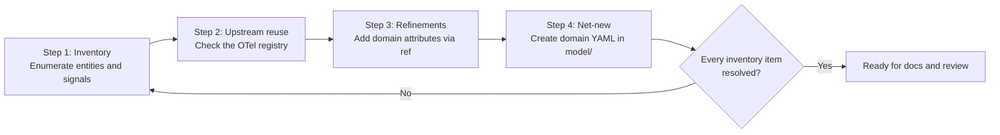

# Contributing

Welcome to the OpenTelemetry Mainframe Semantic Conventions repository!

New to OpenTelemetry? Read the
[New Contributor Guide](https://github.com/open-telemetry/community/blob/main/guides/contributor/README.md)
first — it covers the CLA, Code of Conduct, and other prerequisites.

## Prerequisites

- [Podman](https://podman.io/) or [Docker](https://docs.docker.com/get-docker/)
  — `make` runs Weaver via the `otel/weaver` container image. The Makefile
  uses `podman` if it is installed and falls back to `docker`. If you have
  several Podman machines, make the running one the default connection
  (`podman system connection default <name>`).
- [GNU Make](https://www.gnu.org/software/make/) — pre-installed on macOS
  and Linux. On Windows, use [WSL](https://learn.microsoft.com/windows/wsl/install)
  or install via [Chocolatey](https://chocolatey.org/) (`choco install make`)
  or [Scoop](https://scoop.sh/) (`scoop install make`).
- [uv](https://docs.astral.sh/uv/) — runs the reference scenarios under
  `reference/`; it fetches the Python version the tooling declares.
- [mise](https://mise.jdx.dev/) (optional) — runs the link checks.

## Code structure

```text
├── docs
│   ├── *.md                        # hand-written docs
│   └── registry/                   # auto-generated registry pages
├── model
│   └── <namespace>/                # e.g. mainframe, virtualization, zos
│       ├── attributes_<concept>.yaml
│       ├── entities.yaml           # entities and entity refinements
│       ├── metrics_<concept>.yaml
│       └── metrics_refinements_<base>.yaml
```

Attributes are defined in `attributes_<concept>.yaml` files under the matching
namespace folder in `model/`. See [File naming](#file-naming) for all file
patterns.

## Authoring principles

### Schema version

Every file under `model/` starts with:

```yaml
file_format: definition/2
```

Do not use the legacy `groups:` syntax in local model files. Upstream
conventions (`host`, `system.*`, `hw.*`, …) are referenced with `ref:` and are
never copied into the local model. See the
[Semantic Convention YAML Language](https://github.com/open-telemetry/weaver/blob/main/schemas/semconv-syntax.md)
for the syntax.

### Minimal model and federated conventions

Express as much of the domain as possible with as little local YAML as
possible. Model authoring follows a strict order of preference:

1. **Upstream reuse:** if an upstream OpenTelemetry concept represents the
   domain element unchanged, reuse it directly.
2. **Refinement:** if an upstream (or another local) concept fits but needs
   domain-specific attributes or entity associations, define an
   `entity_refinements` or `metric_refinements` entry.
3. **Net-new:** only if nothing fits, create a new definition under
   `model/<namespace>/`.

### Signal types

The authoring process below applies to every signal type — metrics, spans,
events and profiles. The model currently defines attributes, entities, entity
refinements, metrics and metric refinements; the rules in
[YAML authoring rules](#yaml-authoring-rules) cover these. For other signal
types, follow the `definition/2` syntax in the Weaver documentation and the
same order of preference.

### Namespaces

- `mainframe`: hardware and firmware layer of IBM Z and LinuxONE (CPC,
  processors, channels, adapters, DPM storage).
- `virtualization`: cross-platform platforms, partitions, hypervisors,
  virtual machines, clusters, resource pools, virtual switches and storage
  pools.
- `zos`: the IBM z/OS operating system layer.
- `<namespace>`: any new platform or domain namespace.

Names are lowercase and dot-separated: `<namespace>.<concept>.<property>`, for
example `mainframe.cpu.type`, `virtualization.partition.name` or
`zos.smf.id`.

### Entity identity

Identifying attributes follow the upstream rules in
[How to define identifying attributes](https://github.com/open-telemetry/semantic-conventions/blob/v1.44.0/docs/how-to-write-conventions/resource-and-entities.md#how-to-define-identifying-attributes):

- They are minimally sufficient to identify the entity within the context in
  which it is discovered, and they MUST NOT change during its lifespan.
- They are the same for every observer. A CPC or LPAR is observed by the HMC,
  z/OS and Linux on IBM Z, so identifiers come from data all of them report
  (machine type and serial number, LPAR name), not from HMC object IDs.
- Names are descriptive. A rename must not end an entity's lifespan, so
  `host.name` and the `*.name` attributes are not identifying. Exceptions are
  names that every observer reports as the stable key, such as LPAR names and
  channel names in `CSS.CHPID` form.
- Generic entities are identified by an `*.id` attribute whose definition
  states the uniqueness scope and how each platform fills it (see
  `virtualization.platform.id`).
- Objects scoped to a CPC (processors, channels, adapters, ports, partition
  NICs, storage groups) include `virtualization.platform.id` in their identity.
- A VM's identity never includes the host or hypervisor it runs on, so it
  survives live migration.

### Units

Use [UCUM](https://ucum.org/) units and, as the upstream
[metric guidelines](https://github.com/open-telemetry/semantic-conventions/blob/v1.44.0/docs/general/metrics.md#instrument-units)
require, non-prefixed units: `By` rather than `MiBy` or `GiBy`, `1` for ratios
in the range 0–1. When a source reports another unit, record the conversion
with the definition (for HMC sources in `annotations.hmc_source`, see
[Net-new metrics](#net-new-metrics)).

## Four-step authoring process



### Step 1 — Inventory

List every domain entity and every piece of telemetry to be supported:

| Entity | Telemetry | Signal Type | Brief Description |
| :--- | :--- | :--- | :--- |
| `mainframe.cpu` | `mainframe.cpu.utilization` | Metric | Busy ratio of one physical processor (0–1) |
| `virtualization.platform` | `system.cpu.utilization` | Metric | CPC CPU utilization by processor type |
| `virtualization.partition` | `virtualization.partition.cpu.weight` | Metric | LPAR processing weight by weight category |

### Step 2 — Upstream reuse

Compare each inventory item with the upstream OpenTelemetry registry. If an
upstream entity or signal models the concept without changes, reference it and
add no YAML. Example: the generic `host` entity and the `hw.*` hardware metrics.

### Step 3 — Refinements

For items that match an upstream or local concept but need additional
attributes, associations or notes, create an `entity_refinements` or
`metric_refinements` entry with `ref: <name>`:

- Metric refinements inherit instrument and unit; never redeclare them.
- Example: `refinement.mainframe.system.cpu.utilization` adds
  `mainframe.cpu.type` and `mainframe.cpu.sharing.mode` to
  `system.cpu.utilization`.
- Refinements also apply across local namespaces: the generic
  `virtualization.partition.cpu.weight` stays platform-neutral, and
  `refinement.mainframe.virtualization.partition.cpu.weight` adds the IBM Z
  attribute `mainframe.partition.weight.type`.

### Step 4 — Net-new definitions

For concepts without any equivalent, create definitions under
`model/<namespace>/` following the [file naming](#file-naming) rules.

### Inventory-to-coverage invariant

Upstream reuse (step 2) + refinements (step 3) + net-new definitions (step 4)
must cover the whole inventory (step 1). No inventory item may be left
unresolved.

## YAML authoring rules

### Entity definitions

Every entity definition includes `type`, `brief`, `stability`,
`requirement_level`, `identity` and `description`. Every attribute referenced
in `description` has an explicit `requirement_level`.

```yaml
file_format: definition/2
entities:
  - type: mainframe.channel
    brief: >
      A mainframe I/O channel, representing a physical channel path that
      connects the Central Processing Complex (CPC) to peripheral devices.
    stability: development
    requirement_level: recommended
    identity:
      - ref: virtualization.platform.id
        note: >
          The Central Processing Complex (CPC) the channel belongs to.
      - ref: mainframe.channel.name
        note: >
          `CSS.CHPID` is unique within one CPC; the bare CHPID is not.
    description:
      - ref: mainframe.channel.mode
        requirement_level: required
      - ref: mainframe.channel.id
        requirement_level: recommended
```

### Entity refinements

Entity refinements extend an upstream or local entity. They include `id`
(pattern `refinement.<namespace>.<concept>[.<base>]`), `ref`, `brief`,
`stability` and `description`, and may declare `identity` when the base entity
declares none.

```yaml
file_format: definition/2
entity_refinements:
  - id: refinement.mainframe.host
    ref: host
    brief: >
      Mainframe refinement of the generic host entity for the IBM Z Central
      Processing Complex (CPC).
    stability: development
    identity:
      - ref: host.id
        note: >
          `<machine type>-<serial number>` of the CPC, with leading zeros
          removed from the serial, e.g. `3931-45A01`; equal to
          `virtualization.platform.id`.
    description:
      - ref: host.name
        requirement_level: recommended
      - ref: mainframe.host.serial_number
        requirement_level: recommended
```

### Metric refinements

Metric refinements add attributes and entity associations to an existing
metric. They include `id` (pattern `refinement.<namespace>.<metric.name>`),
`ref`, `brief`, `stability`, `entity_associations` and `attributes`. Do **not**
include `instrument` or `unit`; they are inherited.

```yaml
file_format: definition/2
metric_refinements:
  - id: refinement.mainframe.system.cpu.utilization
    ref: system.cpu.utilization
    brief: "Per-logical-CPU utilization by mode, extended for IBM Z processor specialization."
    stability: development
    entity_associations:
      - virtualization.platform
      - virtualization.partition
    attributes:
      - ref: mainframe.cpu.type
        requirement_level: required
      - ref: mainframe.cpu.sharing.mode
        requirement_level: opt_in
```

### Net-new metrics

Net-new metrics include `name`, `brief`, `instrument`, `unit`, `stability` and
`entity_associations`. When the value comes from a known source, record it in
`annotations`. Metrics sourced from the IBM Z HMC Web Services API carry an
`hmc_source` block that names the metric group or object property, the field,
the mode (`classic`, `dpm` or `all`), the minimum HMC version where one applies,
and any unit conversion:

```yaml
file_format: definition/2
metrics:
  - name: mainframe.cpu.utilization
    brief: "The fraction of time the mainframe physical processor was busy executing work, as a ratio from 0 (idle) to 1 (fully utilised)."
    instrument: gauge
    unit: "1"
    stability: development
    requirement_level: recommended
    annotations:
      code_generation:
        metric_value_type: double
      hmc_source:
        sources:
          - type: metric_group
            name: zcpc-processor-usage
            field: processor-usage
            mode: all
            unit_transformation:
              hmc_unit: "%"
              otel_unit: "1"
              formula: "value / 100"
              multiplier: 0.01
    entity_associations:
      - mainframe.cpu
    attributes:
      - ref: mainframe.cpu.name
        requirement_level: required
```

Object properties use `type: object_property` with `object:` instead of
`name:`. A metric with several sources lists one entry per source field.

### Attribute definitions

Attributes are declared in `attributes_<concept>.yaml`. Every attribute
includes `key`, `type` (a primitive type or an enum with `members`), `brief`
and `stability`. Use `note` for the semantics a consumer needs, and, for an
identifying `*.id` attribute, for its uniqueness scope and per-platform fill
rules.

```yaml
file_format: definition/2
attributes:
  - key: mainframe.cpu.type
    stability: development
    brief: "The type of mainframe processor within the Central Processing Complex (CPC)."
    type:
      members:
        - id: cp
          value: "cp"
          brief: "Central Processor (CP), the general-purpose processor that hosts a mainframe operating system such as z/OS."
          stability: development
        - id: ifl
          value: "ifl"
          brief: "Integrated Facility for Linux (IFL), a processor dedicated to running Linux workloads on the mainframe."
          stability: development
```

### File naming

| File Pattern | Content | Example |
| :--- | :--- | :--- |
| `attributes_<concept>.yaml` | Attribute definitions | `model/mainframe/attributes_cpu.yaml` |
| `entities.yaml` or `entities_<concept>.yaml` | Entity definitions and entity refinements | `model/mainframe/entities_dpm.yaml` |
| `metrics_<concept>.yaml` | Net-new metric definitions | `model/mainframe/metrics_cpu.yaml` |
| `metrics_refinements_<base>.yaml` | Metric refinements, grouped by the refined namespace | `model/mainframe/metrics_refinements_system.yaml` |

Use the same pattern for other signal types when they are added, for example
`spans_<concept>.yaml` and `events_<concept>.yaml`.

### Stability

Stability progresses in one direction: `development` → `release_candidate` →
`stable`.

- All new definitions start at `development`; every definition in this
  repository is currently at `development`.
- `release_candidate` is the optional step upstream uses before `stable`.
  Promoting directly from `development` to `stable` is allowed but should be a
  deliberate, reviewed decision.
- Never downgrade stability.
- Do not use the legacy `experimental` and `alpha` values in new definitions.

## Making a change

### 1. Modify the YAML model

Create or update the files under `model/<namespace>/` following the
[authoring principles](#authoring-principles), the
[four-step authoring process](#four-step-authoring-process) and the
[YAML authoring rules](#yaml-authoring-rules).

### 2. Regenerate the docs

After updating the YAML, run:

```bash
make generate-all
```

This regenerates the registry pages under `docs/registry/` (one page per
definition kind a namespace uses — `entities.md`, `entity-refinements.md`,
`metrics.md`, `metric-refinements.md` — plus the namespace `README.md`) and the
reference reports. Commit the regenerated files with your change; CI checks
that they match what `make generate-all` produces.

`make generate-docs` refreshes the tables that Weaver embeds in hand-written
pages between `<!-- weaver ... -->` markers. Run it if you add such markers.

### 3. Validate

Run the shared policy checks:

```bash
make check-policies
```

This validates the model against shared OpenTelemetry policies covering
naming conventions, attribute type rules, stability requirements, and
backwards compatibility, plus the repository's own policies under
`policies/check/`.

Optionally, emit one synthetic data point for every signal of the resolved
registry to see what the conventions produce:

```bash
make emit                                                      # print to stdout
make emit OTLP_ENDPOINT=http://host.containers.internal:4317   # send to a collector (Podman)
make emit OTLP_ENDPOINT=http://host.docker.internal:4317       # send to a collector (Docker)
```

Weaver runs in a container, so `localhost` refers to the container; use the
host alias of your container runtime to reach a collector on your machine.

Run the link checks (optional, requires [mise](https://mise.jdx.dev/)):

```bash
mise run links
```

CI checks every local link in the repository, so links between hand-written
pages must point to files that exist in the same pull request.

### 4. Update reference scenarios

Changes under `model/` or `docs/` typically require updating the reference
scenarios under `reference/` to demonstrate that the proposed updates are
capturable. Each scenario lives in `reference/scenarios/<feature>/` with a
`scenario.py`, a `pyproject.toml`, a committed `uv.lock` and the committed
results in `data.json`. The shared framework in `reference/src/` runs a
scenario, validates the emitted telemetry against the conventions and writes
the results that feed the reports.

Run the commands from the `reference/` directory:

```bash
uv sync                                   # first-time setup
uv run run-scenario <feature>             # run one scenario
uv run run-scenario --all                 # run all scenarios
uv run run-scenario --all --keep-going    # report all failures at the end
uv run update-reports                     # regenerate the status section in reference/README.md
```

Requirements:

- Every entity type that carries a signal you add or change is exercised by a
  scenario, and its identifying attributes are filled as the attribute
  definitions describe.
- Emit only what the reference can actually produce. If a source emits
  unrelated telemetry that obscures the validation, suppress it in the
  scenario rather than changing the conventions to match it.
- After regenerating `scenarios/*/data.json`, run `uv run update-reports` and
  commit both with your change.

See [reference/CONTRIBUTING.md](reference/CONTRIBUTING.md) for the scenario
layout, dependency pinning and linting.

### 5. Update the documentation

Documentation comes in two forms:

- **Generated registry pages** under `docs/registry/<namespace>/` are produced
  by `make generate-all` and MUST NOT be edited by hand. Their text comes from
  the `brief` and `note` fields of the model, so write those fields carefully
  and check how they render.
- **Hand-written pages** under `docs/` carry what cannot be derived from the
  model: design rationale and diagrams (`mainframe-discovered.md`,
  `virtualization-discovered.md`), platform implementation guides
  (`virtualization-vmware.md`, `virtualization-kvm.md`) and the IBM Z HMC
  Web Services API background and cross-reference (`hmc-api-background.md`,
  `hmc-api-signal-mapping.md`).

When you change the model:

- Every attribute, metric, entity and refinement name used in a hand-written
  page must exist in the model or the upstream registry. Update the pages that
  use a name you rename or remove.
- If a definition carries `annotations.hmc_source`, add or update the matching
  rows in `docs/hmc-api-signal-mapping.md` in the same pull request. The
  annotation is authoritative; the page only covers signals with an HMC source.
- Do not repeat content that the registry pages already show, such as
  complete metric-to-entity association lists; link to the registry pages
  instead.

### 6. Update the changelog

Add a Towncrier fragment under [changelog.d/](changelog.d/) for any change to
the conventions that a consumer would care about. Editorial changes — typos,
pure rewording, and repo tooling — don't need an entry.

Use a filename of `<pr-number>.<type>.md` once the pull request number is
known, or `+.<type>.md` before then. Add a numeric counter before `.md` when
one pull request needs multiple fragments of the same type. See
[changelog.d/README.md](changelog.d/README.md) for the supported types.

### Adding a new namespace

To add a namespace (for example a new platform or operating system layer):

1. **Inventory:** list all target entities and signals
   ([step 1](#step-1--inventory)).
2. **Upstream:** check the OpenTelemetry registry for reusable entities and
   signals ([step 2](#step-2--upstream-reuse)).
3. **Directory:** create `model/<namespace>/`.
4. **Definitions:** add `attributes_<concept>.yaml`, `entities.yaml`,
   `metrics_<concept>.yaml` and, for refinements of other namespaces,
   `metrics_refinements_<base>.yaml`, each starting with
   `file_format: definition/2` (see [File naming](#file-naming)). Define the
   identifying attributes of every entity following
   [Entity identity](#entity-identity).
5. **Generate and validate:** run `make generate-all` and
   `make check-policies`.
6. **Reference scenario:** add or extend a scenario under
   `reference/scenarios/` that emits the new signals, then run
   `uv run run-scenario <feature>` and `uv run update-reports`.
7. **Documentation:** check the generated registry pages and add narrative or
   source-mapping pages under `docs/` where needed.
8. **Changelog:** add a fragment under `changelog.d/`.

## Keep PRs small

Small, focused PRs are much easier to review, and therefore much more
likely to land quickly. Consider phasing larger changes across multiple PRs
where possible.

If a PR review surfaces contentious or difficult points, consider splitting
those into follow-up PRs so the uncontroversial parts can land and each of the
harder points gets its own focused discussion and review.

## Asking questions

Post in
[#otel-mainframes](https://cloud-native.slack.com/archives/C05PXDFTCPJ)
on [CNCF Slack](https://slack.cncf.io/) or join the next
[Mainframe SIG](https://github.com/open-telemetry/community#sig-mainframes)
and add your topic to the
[meeting agenda](https://docs.google.com/document/d/14p-bpofozTL4n3jy6HZH_TKjoOXvog18G1HBRqq6liE/edit).

## Approvers and Maintainers

### Maintainers

- [Antoine Toulme](https://github.com/atoulme), Splunk
- [Matt Hogstrom](https://github.com/hogstrom), Broadcom
- [Ruediger Schulze](https://github.com/rrschulze), IBM

For more information about the maintainer role, see the [community repository](https://github.com/open-telemetry/community/blob/main/guides/contributor/membership.md#maintainer).

### Approvers

- [Antoine Toulme](https://github.com/atoulme), Splunk
- [Matt Hogstrom](https://github.com/hogstrom), Broadcom
- [Ruediger Schulze](https://github.com/rrschulze), IBM

For more information about the approver role, see the [community repository](https://github.com/open-telemetry/community/blob/main/guides/contributor/membership.md#approver).

Approvers assign themselves to non-editorial PRs
to signal that they will drive the review. A PR can have multiple
approvers assigned, and that is highly encouraged for medium and high
complexity PRs.

Over a rolling 3-month window, an approver is expected to sign up for and
drive the review of at least 3 non-editorial PRs.
"Driving the review" means staying engaged with the PR through to its
merge or close: providing timely initial reviews and follow-up feedback,
requesting changes, asking design questions, and re-reviewing revisions
promptly until the PR lands or is rejected.
