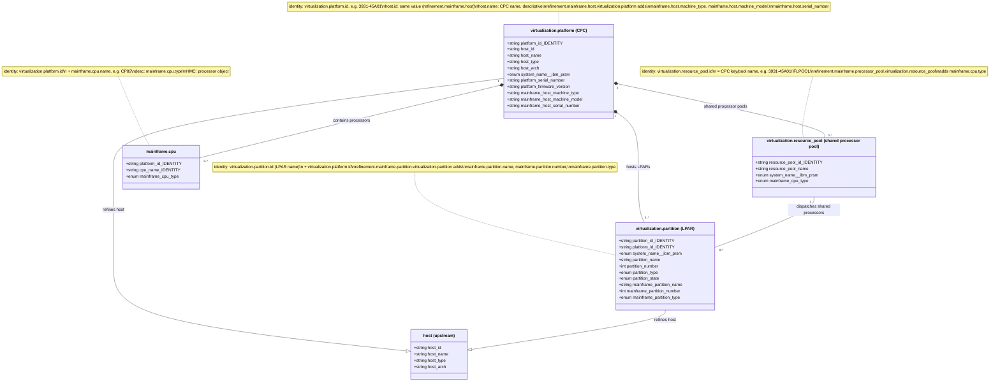
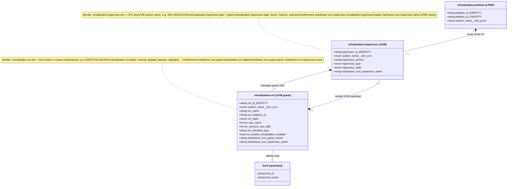
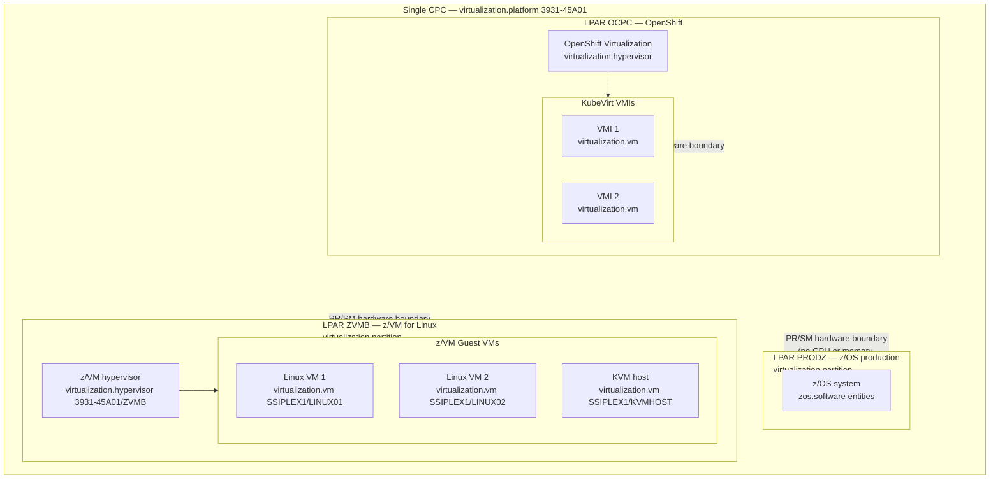

# Mainframe Semantic Conventions — Visual Semantic Models & Architecture

> **Scope:** This document illustrates the entity model, metric associations and cross-platform
> topology defined in `model/mainframe/` and `model/virtualization/` for the IBM Z mainframe
> observability domain, with Mermaid diagrams and a short architecture summary. Entity types,
> attribute keys and metric names are those of the `definition/2` YAML files. The generated
> registry pages under [docs/registry/mainframe/](registry/mainframe/README.md) are authoritative
> for the complete attribute and metric lists ([entities](registry/mainframe/entities.md),
> [metrics](registry/mainframe/metrics.md),
> [entity refinements](registry/mainframe/entity-refinements.md),
> [metric refinements](registry/mainframe/metric-refinements.md)); the diagrams below show
> selected attributes and metrics only. The generic virtualization model is described in
> `docs/virtualization-discovered.md`.

---

## 1. Executive Summary

### Design Lessons & Trade-offs

The mainframe semantic conventions answer one architectural question: *How do we describe the
IBM Z compute stack — from the Central Processing Complex (CPC) to a z/VM guest — with the same
entity model that also covers VMware vSphere, KVM and OpenShift Virtualization?*

Seven lessons shaped the design:

**1. One CPC, one key, two views.**
The CPC is a `virtualization.platform`. Two entity refinements describe it further:
`refinement.mainframe.host.virtualization.platform` adds `mainframe.host.machine_type`,
`mainframe.host.machine_model` and `mainframe.host.serial_number`, and `refinement.mainframe.host`
presents the CPC as a generic upstream `host`, identified by `host.id`. Both views carry the same
key, `<machine type>-<serial number>` (for example `3931-45A01`), in `virtualization.platform.id`
and `host.id`, so consumers of either view see the same CPC. All CPC metrics — the
`mainframe.host.*` metrics and the generic `virtualization.platform.*` metrics — are associated
with `virtualization.platform`. There is no separate mainframe host entity type; `mainframe.host.*`
is only the name prefix of the CPC metrics and attributes.

**2. `virtualization.partition` fills the firmware-partitioning gap.**
PR/SM logical partitions (LPARs) are enforced by firmware, not by software. They are neither VMs
(no software hypervisor) nor bare-metal hosts (they share physical hardware).
`virtualization.partition` models this concept; its identity is the LPAR name
(`virtualization.partition.id`) together with the CPC key (`virtualization.platform.id`), because
LPAR names are unique only within one CPC. `refinement.mainframe.partition.virtualization.partition`
adds `mainframe.partition.name`, `mainframe.partition.number` and `mainframe.partition.type`.

**3. The `ibm.prsm` discriminator enables single-label filtering.**
Setting `virtualization.system.name` to `ibm.prsm` on every PR/SM entity lets a query isolate IBM Z
PR/SM metrics with `{virtualization_system_name="ibm.prsm"}`. Likewise, `ibm.zvm` isolates the
z/VM layer.

**4. Processor type is a metric attribute, not an entity split.**
IBM Z has several processor types (CP, IFL, zIIP, ICF, SAP, and on some machine generations AAP
and CBP), each assigned to different work. Rather than creating an entity type per processor
type, the model uses `mainframe.cpu.type` as an attribute on the CPC- and LPAR-level processor
metrics (`mainframe.host.cpu.utilization`, `mainframe.host.cpu.active.count`,
`mainframe.partition.cpu.utilization`, and others) and on the refinement of
`system.cpu.utilization`. SAP and CBP counts, for example, are `mainframe.host.cpu.active.count`
with `mainframe.cpu.type` set to `sap` or `cbp`. For an individual processor (`mainframe.cpu`),
the type is a descriptive attribute of the entity.

**5. `mainframe.*` entities only where nothing else fits.**
Seven entity types have no upstream or generic virtualization analogue: `mainframe.cpu`
(physical processor), `mainframe.channel` (channel path), `mainframe.adapter` (I/O adapter),
`mainframe.adapter.port` (physical adapter port), `mainframe.partition.nic` (virtual NIC of a DPM
partition), `mainframe.storage.group` and `mainframe.storage.group.volume` (DPM storage). All other
IBM Z constructs reuse the `virtualization.*` entities with a mainframe refinement and the
`ibm.prsm` or `ibm.zvm` discriminator.

**6. CPC-scoped objects carry the CPC in their identity.**
One HMC manages several CPCs, and processor names (`CP02`), channel names (`0.2D`) and adapter
PCHIDs (`014`) repeat on every CPC. Every CPC-scoped mainframe entity therefore includes
`virtualization.platform.id` in its identity. HMC object IDs are not used as identifiers: z/OS
and Linux on IBM Z observe the same CPCs and LPARs but cannot see HMC-internal IDs, while machine
type, serial number and LPAR name are reported by all three observers.

**7. Nested virtualization is an attribute pattern, not a new entity type.**
When z/VM runs inside an LPAR, the LPAR is a `virtualization.partition` and the z/VM Control
Program is a `virtualization.hypervisor`, refined by
`refinement.mainframe.zvm.hypervisor.virtualization.hypervisor`. z/VM guests are
`virtualization.vm` entities, refined by `refinement.mainframe.zvm.guest.virtualization.vm`. The
layers are correlated through `virtualization.platform.id` and the LPAR name that hosts z/VM
(`mainframe.zvm.hypervisor.name`).

---

## 2. CPC, LPAR & Partitioning ERD

The first diagram shows the CPC and firmware partitioning entities, their identity attributes,
selected descriptive attributes and the `host` refinement lineage.

**Notes:**

- `_IDENTITY` marks attributes in the entity `identity:` block. All other attributes are
  descriptive.
- The CPC refines `host` twice: `refinement.virtualization.platform.host` (generic, for every
  virtualization platform) and `refinement.mainframe.host` (IBM Z specific, identified by
  `host.id`). `host.id` and `virtualization.platform.id` carry the same value, so the CPC host and
  the CPC platform stay aligned.
- `virtualization.partition` has a composite identity because LPAR names are unique only within a
  single CPC. The mainframe-specific partition attributes come from an entity refinement; there is
  no separate mainframe partition entity type.
- `mainframe.partition.number` (1–64) is descriptive. It correlates HMC data with SMF records and
  hardware logs that refer to partitions by number.

---

## 3. Hypervisor & Guest VM ERD

The second diagram shows the z/VM hypervisor layer and its guest VM entities.

**Notes:**

- z/VM runs inside a `virtualization.partition`. Its hypervisor ID is the z/VM system name
  qualified by the CPC key.
- A z/VM guest is identified by the SSI cluster name (or the z/VM system name outside an SSI
  cluster) and its 1–8 character user ID. The identity does not contain the z/VM system the guest
  currently runs on, so it survives Live Guest Relocation within the SSI cluster; the current
  hypervisor is the descriptive attribute `mainframe.zvm.hypervisor.name`.
- Nested virtualization: z/VM can run a second z/VM instance inside a guest. The inner z/VM
  appears as a `virtualization.vm` to the outer z/VM, and its own `virtualization.hypervisor`
  entity represents the nested Control Program.
- KVM on IBM Z identifies guests by the libvirt domain UUID in `virtualization.vm.id` and sets
  `virtualization.system.name` to `kvm`; see the KVM guide in `docs/virtualization-kvm.md`.

---

## 4. Channel, Adapter & Port ERD

The third diagram shows the physical I/O entities: channel paths, I/O adapters and the physical
ports of network adapters.

```mermaid
classDiagram
    class virt_platform["virtualization.platform (CPC)"] {
        +string platform_id_IDENTITY
    }

    class mf_channel["mainframe.channel"] {
        +string platform_id_IDENTITY
        +string channel_name_IDENTITY
        +string channel_id
        +enum channel_type
        +enum channel_mode
        +string channel_owning_partition
    }

    class mf_adapter["mainframe.adapter"] {
        +string platform_id_IDENTITY
        +string adapter_id_IDENTITY
        +string adapter_name
        +enum adapter_type
        +string adapter_owning_partition
    }

    class mf_port["mainframe.adapter.port"] {
        +string platform_id_IDENTITY
        +string adapter_id_IDENTITY
        +string port_id_IDENTITY
        +string host_name
    }

    note for mf_channel "identity: virtualization.platform.id\n  + mainframe.channel.name (CSS.CHPID, e.g. 0.2D)\ndesc: mainframe.channel.id (CHPID, e.g. 2D),\nmainframe.channel.type, mainframe.channel.mode,\nmainframe.channel.owning.partition\nHMC: channel-path object, channel-usage metric group"
    note for mf_adapter "identity: virtualization.platform.id\n  + mainframe.adapter.id (PCHID, e.g. 014)\ndesc: mainframe.adapter.name (HMC name, descriptive),\nmainframe.adapter.type, mainframe.adapter.owning.partition\nHMC: adapter object adapter-id, name, type"
    note for mf_port "identity: virtualization.platform.id\n  + mainframe.adapter.id + mainframe.adapter.port.id\nHMC: network-physical-adapter-port network-port-id\nDPM mode"

    %% Containment
    virt_platform "1" *-- "0..*" mf_channel : owns channel paths
    virt_platform "1" *-- "0..*" mf_adapter : owns I/O adapters
    mf_adapter "1" *-- "0..*" mf_port : has physical ports
```

**Notes:**

- A channel is identified by `CSS.CHPID`, which is unique within a CPC. The bare CHPID
  (`mainframe.channel.id`) repeats across channel subsystems and is descriptive.
- An adapter is identified by its PCHID (`mainframe.adapter.id`), the adapter's physical location
  in the CPC. The HMC adapter name (`mainframe.adapter.name`, e.g. `OSD 0114`) is user-assignable
  and descriptive.

**Channel type reference (`mainframe.channel.type`):**

| Enum Value | Description |
| --- | --- |
| `ficon` | Fibre Channel Connection (FICON) channel path for DASD and tape storage connectivity |
| `zhyperlink` | zHyperLink Express channel path providing low-latency synchronous PCIe storage access |
| `osa` | Open Systems Adapter (OSA) channel path for Ethernet LAN connectivity |
| `roce` | RDMA over Converged Ethernet (RoCE) channel path for memory-to-memory data transfers |
| `coupling` | Coupling Facility link (Integrated Cluster Bus or Coupling Express) for sysplex communication |

**Adapter type reference (`mainframe.adapter.type`):**

| Enum Value | Description |
| --- | --- |
| `crypto` | Cryptographic adapter providing hardware-accelerated encryption and key management |
| `flash` | Flash Express adapter providing solid-state storage for IBM Virtual Flash Memory (VFM) |
| `roce` | RDMA over Converged Ethernet (RoCE) adapter for low-latency RDMA networking |
| `accelerator` | Accelerator adapter for workloads such as compression or AI inference |
| `network` | Network adapter providing connectivity to external networks |
| `storage` | Storage adapter providing connectivity to external storage such as SAN or NVMe-oF |

---

## 5. Network & Storage Virtualization ERD

The fourth diagram shows the virtual networking and storage entities of the PR/SM (DPM) and z/VM
layers.

```mermaid
classDiagram
    class virt_vswitch["virtualization.vswitch"] {
        +string vswitch_id_IDENTITY
        +string vswitch_name
        +enum system_name
        +string mainframe_vswitch_name
    }

    class virt_storage_pool["virtualization.storage_pool (DPM storage group)"] {
        +string storage_pool_id_IDENTITY
        +string storage_pool_name
        +enum system_name__ibm_prsm
        +string mainframe_storage_group_name
        +enum mainframe_storage_group_type
    }

    class mf_sg["mainframe.storage.group"] {
        +string platform_id_IDENTITY
        +string group_name_IDENTITY
        +enum group_type
        +string host_name
    }

    class mf_vol["mainframe.storage.group.volume"] {
        +string platform_id_IDENTITY
        +string group_name_IDENTITY
        +string volume_name_IDENTITY
        +string host_name
    }

    class mf_nic["mainframe.partition.nic"] {
        +string platform_id_IDENTITY
        +string partition_id_IDENTITY
        +string nic_name_IDENTITY
        +string adapter_id
        +string port_id
        +string host_name
    }

    class mf_port["mainframe.adapter.port"] {
        +string port_id_IDENTITY
    }

    class virt_partition["virtualization.partition (LPAR)"] {
        +string partition_id_IDENTITY
        +string platform_id_IDENTITY
    }

    class virt_vm["virtualization.vm (z/VM guest)"] {
        +string vm_id_IDENTITY
    }

    note for virt_vswitch "identity: virtualization.vswitch.id\nz/VM: 3931-45A01/ZVM1/VSWITCH1\nDPM: 3931-45A01/104.P0.OSD\nrefinement.mainframe.vswitch.virtualization.vswitch\nadds mainframe.vswitch.name"
    note for virt_storage_pool "identity: virtualization.storage_pool.id\n  = CPC key/storage group name, e.g. 3931-45A01/SG-PROD\nrefinement.mainframe.storage_group.virtualization.storage_pool\nadds mainframe.storage.group.name, mainframe.storage.group.type"
    note for mf_sg "identity: virtualization.platform.id\n  + mainframe.storage.group.name\ndesc: mainframe.storage.group.type (fcp, fc, nvme)\nHMC: storage-group object, DPM, HMC 2.14.1 or later"
    note for mf_nic "identity: virtualization.platform.id\n  + virtualization.partition.id + mainframe.partition.nic.name\ndesc: mainframe.adapter.id, mainframe.adapter.port.id\n(the backing physical port)\nHMC: partition-attached-network-interface nic-id, DPM"

    %% z/VM and DPM virtual networking
    virt_vswitch "1" *-- "0..*" virt_vm : carries guest VM traffic
    virt_vswitch "1" *-- "0..*" virt_partition : carries partition traffic

    %% DPM partition NICs
    virt_partition "1" *-- "0..*" mf_nic : has virtual NICs (DPM)
    mf_nic "0..*" --> "1" mf_port : backed by

    %% DPM storage
    virt_storage_pool "1" -- "1" mf_sg : same storage group
    mf_sg "1" *-- "0..*" mf_vol : contains volumes
    virt_storage_pool "1" *-- "0..*" virt_partition : backs DPM partition volumes
```

**Notes:**

- A DPM storage group appears in two views: as the generic `virtualization.storage_pool` (for
  cross-platform storage metrics) and as `mainframe.storage.group` (for the DPM-specific capacity
  metrics and its volumes). Both identifiers contain the CPC key and the storage group name.
- A DPM partition NIC is identified within its partition; it follows the partition's identity
  (CPC key and partition name).

**Storage pool discriminator (`virtualization.system.name`):**

| Value | Context | Storage Construct |
| --- | --- | --- |
| `ibm.prsm` | HMC DPM mode | DPM storage group (FCP, FC/ECKD or NVMe volumes) |
| `ibm.zvm` | z/VM | Minidisk or DASD pools; no identifier fill rule is defined for them yet |

---

## 6. Cross-Platform Topology Lineage

This diagram shows how each IBM Z virtualization layer maps its native constructs to the entity
schema. All paths converge on the same entity types and metric definitions, discriminated by
`virtualization.system.name`. Edge labels show how the identifying attributes are filled.

```mermaid
flowchart TD
    subgraph Physical ["L0 — Physical Infrastructure"]
        CPC["Central Processing Complex<br/>(z17 / z16 / z15)"]
        PROC["Processors<br/>CP, IFL, zIIP, ICF, SAP"]
        CHPID["Channel Paths (CHPIDs)<br/>FICON, OSA, RoCE, zHyperLink, coupling"]
        ADAPTER["I/O Adapters (PCHIDs)<br/>Crypto, Flash, RoCE, network, storage"]
        ENV["Environmental Sensors<br/>Power, Temperature, Humidity, Heat load"]
    end

    subgraph PRSM_Classic ["L1 — PR/SM Classic Mode"]
        LPAR["Logical Partition (LPAR)"]
        POOL["Shared Processor Pool"]
    end

    subgraph PRSM_DPM ["L1 — PR/SM DPM Mode"]
        DPM_PART["DPM Partition"]
        SG["DPM Storage Group<br/>FCP, FC, NVMe"]
        DPM_NIC["Virtual NIC<br/>attached to DPM partition"]
    end

    subgraph ZVM ["L2 — IBM z/VM Control Program"]
        ZVM_CP["z/VM CP Hypervisor"]
        GUEST["Guest Virtual Machine<br/>z/VM user directory entry"]
        VSW["VSWITCH<br/>z/VM virtual switch"]
    end

    subgraph KVM ["L2 — Linux KVM on IBM Z"]
        KVM_HOST["KVM Host<br/>Linux in an LPAR"]
        KVM_GUEST["KVM Guest VM<br/>libvirt domain"]
        KVM_NET["Linux Bridge / OVS bridge"]
    end

    subgraph OCP ["L2 — OpenShift Virtualization (s390x)"]
        OCP_NODE["OpenShift Worker Node<br/>KubeVirt virt-handler"]
        VMI["VirtualMachineInstance"]
        OCP_NS["Namespace ResourceQuota"]
        OCP_NET["OVN-Kubernetes Network"]
    end

    subgraph OTel_Entities ["OTel Semantic Convention Entities"]
        direction TB
        E_PLAT["virtualization.platform<br/>+ host refinements<br/>ibm.prsm"]
        E_CPU["mainframe.cpu"]
        E_PART["virtualization.partition<br/>ibm.prsm"]
        E_RP["virtualization.resource_pool<br/>ibm.prsm / openshift_virtualization"]
        E_CHAN["mainframe.channel"]
        E_ADAPT["mainframe.adapter"]
        E_PORT["mainframe.adapter.port"]
        E_NIC["mainframe.partition.nic"]
        E_SG["mainframe.storage.group"]
        E_POOL["virtualization.storage_pool<br/>ibm.prsm"]
        E_HYP["virtualization.hypervisor<br/>ibm.zvm / kvm / openshift_virtualization"]
        E_VM["virtualization.vm<br/>ibm.zvm / kvm / openshift_virtualization"]
        E_VSW["virtualization.vswitch<br/>ibm.zvm / kvm / openshift_virtualization"]
    end

    %% Physical layer mappings
    CPC     -->|"virtualization.platform.id = host.id = machine type-serial<br/>host.name = CPC name"| E_PLAT
    PROC    -->|"virtualization.platform.id + mainframe.cpu.name, e.g. CP02"| E_CPU
    CHPID   -->|"virtualization.platform.id + mainframe.channel.name = CSS.CHPID"| E_CHAN
    ADAPTER -->|"virtualization.platform.id + mainframe.adapter.id = PCHID"| E_ADAPT
    ADAPTER -->|"mainframe.adapter.port.id = network-port-id"| E_PORT
    ENV     -->|"mainframe.host.power.usage, mainframe.host.humidity, ..."| E_PLAT

    %% PR/SM classic mode mappings
    LPAR -->|"virtualization.partition.id = LPAR name<br/>virtualization.platform.id = CPC key"| E_PART
    POOL -->|"virtualization.resource_pool.id = CPC key/pool name"| E_RP

    %% PR/SM DPM mode mappings
    DPM_PART -->|"virtualization.partition.id = partition name"| E_PART
    SG       -->|"virtualization.platform.id + mainframe.storage.group.name"| E_SG
    SG       -->|"virtualization.storage_pool.id = CPC key/storage group name"| E_POOL
    DPM_NIC  -->|"mainframe.partition.nic.name = nic-id"| E_NIC

    %% z/VM layer mappings
    ZVM_CP -->|"virtualization.hypervisor.id = CPC key/z/VM system name"| E_HYP
    GUEST  -->|"virtualization.vm.id = SSI cluster or system name/userid"| E_VM
    VSW    -->|"virtualization.vswitch.id = hypervisor id/VSWITCH name"| E_VSW

    %% KVM layer mappings
    KVM_HOST  -->|"virtualization.hypervisor.id = libvirt host UUID"| E_HYP
    KVM_GUEST -->|"virtualization.vm.id = domain UUID"| E_VM
    KVM_NET   -->|"virtualization.vswitch.id = host machine ID/bridge name"| E_VSW

    %% OpenShift Virtualization mappings (no identifier fill rules defined yet)
    OCP_NODE -->|"virtualization.system.name = openshift_virtualization"| E_HYP
    VMI      -->|"virtualization.system.name = openshift_virtualization"| E_VM
    OCP_NS   -->|"virtualization.system.name = openshift_virtualization"| E_RP
    OCP_NET  -->|"virtualization.system.name = openshift_virtualization"| E_VSW
```

On IBM Z the physical platform is always the CPC. A Linux KVM host or an OpenShift node that runs
in an LPAR (or a z/VM guest) is therefore mapped to a `virtualization.hypervisor` running in that
partition, not to a second `virtualization.platform`. Identifier fill rules for OpenShift
Virtualization are not defined yet.

---

## 7. IBM Z Processor Type Dimension

The `mainframe.cpu.type` attribute is the IBM Z-specific dimension of the processor metrics. It
appears on one refinement and several net-new metrics, and describes the `mainframe.cpu` entity:

```mermaid
classDiagram
    class M_cpu_util["system.cpu.utilization"] {
        <<mainframe refinement>>
        +instrument gauge
        +unit 1
        +dim mainframe_cpu_type
        +dim mainframe_cpu_sharing_mode_opt_in
    }
    class M_host_util["mainframe.host.cpu.utilization"] {
        <<net-new>>
        +instrument gauge
        +unit 1
        +dim mainframe_cpu_type
        +dim mainframe_cpu_sharing_mode
    }
    class M_host_count["mainframe.host.cpu.active.count"] {
        <<net-new>>
        +instrument updowncounter
        +unit cpu
        +dim mainframe_cpu_type
    }
    class M_part_util["mainframe.partition.cpu.utilization"] {
        <<net-new>>
        +instrument gauge
        +unit 1
        +dim mainframe_cpu_type
    }
    class M_part_count["LPAR processor counts"] {
        <<net-new>>
        +instrument updowncounter
        +unit cpu
        +dim mainframe_cpu_type
    }
    class M_cpu_core["mainframe.cpu.utilization"] {
        <<net-new>>
        +instrument gauge
        +unit 1
        +entity mainframe_cpu
    }

    class CpuType["mainframe.cpu.type enum"] {
        <<attribute enum>>
        +cp Central Processor
        +ifl Integrated Facility for Linux
        +iip z Integrated Information Processor
        +icf Integrated Coupling Facility
        +sap System Assist Processor
        +aap Application Assist Processor
        +cbp Container Based Processor
        +all all processor types combined
    }

    note for M_cpu_util "refinement.mainframe.system.cpu.utilization\nentities: virtualization.platform, virtualization.partition"
    note for M_host_util "entity: virtualization.platform\nHMC: cpc-usage-overview, e.g. ifl-shared-processor-usage\nclassic mode, percent divided by 100"
    note for M_host_count "entity: virtualization.platform\nHMC: CPC processor-count-general-purpose, -ifl, -icf,\n-iip, -service-assist, -cbp"
    note for M_part_util "entity: virtualization.partition\nHMC: logical-partition-usage cp-, ifl-, icf-, iip-processor-usage\nDPM partition-usage: aggregate only, no type"
    note for M_part_count "mainframe.partition.cpu.virtual.count\nmainframe.partition.cpu.reserved.count\nmainframe.partition.cpu.capped.count"
    note for M_cpu_core "entity: mainframe.cpu, per physical processor\nHMC: zcpc-processor-usage processor-usage\nalso mainframe.cpu.thread0.utilization,\nmainframe.cpu.thread1.utilization,\nmainframe.cpu.smt_mode.utilization"

    M_cpu_util   -- CpuType : split by
    M_host_util  -- CpuType : split by
    M_host_count -- CpuType : split by
    M_part_util  -- CpuType : split by
    M_part_count -- CpuType : split by
    M_cpu_core   -- CpuType : described by
```

**Processor type reference:**

| `mainframe.cpu.type` | Full Name | Primary Workload | Notes |
| --- | --- | --- | --- |
| `cp` | Central Processor | z/OS and all other operating systems | General-purpose processor |
| `ifl` | Integrated Facility for Linux | Linux on IBM Z, z/VM | |
| `iip` | z Integrated Information Processor (zIIP) | Eligible z/OS work such as Java | Offloads work from CPs |
| `icf` | Integrated Coupling Facility | Coupling facility in a Parallel Sysplex | |
| `sap` | System Assist Processor | I/O and system management | Not available to operating systems; counted with `mainframe.host.cpu.active.count` |
| `aap` | Application Assist Processor (zAAP) | Java and XML processing | Earlier machine generations; HMC still reports `absolute-aap-capping` |
| `cbp` | Container Based Processor | Container-based workloads | Reported only by HMC/SE versions 2.14.0 through 2.15.0 (`processor-count-cbp`) |
| `all` | All processor types combined | — | Aggregate value |

The generic `virtualization.partition.cpu.type` attribute (used by the `virtualization.partition.*`
metrics) has a separate enum: it has no `sap` value and adds `unknown` for platforms that do not
differentiate processor types.

---

## 8. Entity Identity & Discriminator Reference

| Entity Type | Identity Attributes | `virtualization.system.name` | Source of the identifying values |
| --- | --- | --- | --- |
| `virtualization.platform` (CPC) | `virtualization.platform.id` | `ibm.prsm` | CPC key, see below |
| `host` (CPC, `refinement.mainframe.host`) | `host.id` | — | Same value as `virtualization.platform.id` |
| `virtualization.partition` (LPAR) | `virtualization.partition.id` + `virtualization.platform.id` | `ibm.prsm` | LPAR name: HMC partition `name`, SMF type 70 `SMF70LPM`, `/proc/sysinfo` `LPAR Name` |
| `virtualization.resource_pool` (shared processor pool) | `virtualization.resource_pool.id` | `ibm.prsm` | CPC key + pool name, e.g. `3931-45A01/IFLPOOL` |
| `mainframe.cpu` | `virtualization.platform.id` + `mainframe.cpu.name` | — | HMC processor `name`, e.g. `CP02` |
| `mainframe.channel` | `virtualization.platform.id` + `mainframe.channel.name` | — | `CSS.CHPID`, e.g. `0.2D` |
| `mainframe.adapter` | `virtualization.platform.id` + `mainframe.adapter.id` | — | HMC adapter `adapter-id` (PCHID), e.g. `014` |
| `mainframe.adapter.port` | `virtualization.platform.id` + `mainframe.adapter.id` + `mainframe.adapter.port.id` | — | `network-port-id` |
| `mainframe.partition.nic` | `virtualization.platform.id` + `virtualization.partition.id` + `mainframe.partition.nic.name` | — | `nic-id` |
| `mainframe.storage.group` | `virtualization.platform.id` + `mainframe.storage.group.name` | — | HMC storage group `name` |
| `mainframe.storage.group.volume` | `virtualization.platform.id` + `mainframe.storage.group.name` + `mainframe.storage.group.volume.name` | — | HMC storage volume `name` |
| `virtualization.storage_pool` (DPM storage group) | `virtualization.storage_pool.id` | `ibm.prsm` | CPC key + storage group name, e.g. `3931-45A01/SG-PROD` |
| `virtualization.hypervisor` (z/VM) | `virtualization.hypervisor.id` | `ibm.zvm` | CPC key + z/VM system name, e.g. `3931-45A01/ZVM1` |
| `virtualization.vm` (z/VM guest) | `virtualization.vm.id` | `ibm.zvm` | SSI cluster name (or z/VM system name) + user ID, e.g. `SSIPLEX1/LINUX01` |
| `virtualization.vswitch` | `virtualization.vswitch.id` | `ibm.zvm` | z/VM: hypervisor ID + VSWITCH name; DPM: CPC key + virtual switch name |
| `zos.software` | `zos.sysplex.name` + `zos.smf.id` + `mainframe.partition.name` | — | Sysplex name, SMF system ID and LPAR name |

### The CPC key

The CPC is identified by its machine type and serial number, the only CPC identifiers that every
observer reports:

| Observer | Machine type | Serial | LPAR |
| --- | --- | --- | --- |
| HMC Web Services API (CPC and partition objects) | `machine-type` | `cpc-serial-number` | partition `name` |
| z/OS RMF, SMF type 70 subtype 1 | `SMF70CPC_TYPE` | `SMF70CSC` | `SMF70LPM` (name), `SMF70LPN` (number) |
| Linux on IBM Z, `/proc/sysinfo` | `Type` | `Sequence Code` | `LPAR Name`, `LPAR Number` |

The canonical form is `<machine type>-<serial without leading zeros>`, for example `3931-45A01`
for machine type `3931` and sequence code `0000000000045A01`. The CPC name (`host.name`), HMC
object IDs and object URIs are not identifying. Open points for the Mainframe SIG are whether the
HMC serial and the SMF and `/proc/sysinfo` sequence code always denote the same number, whether
the plant of manufacture must be part of the key, and which name a DPM partition reports as its
LPAR name.

---

## 9. Multi-Tenant Isolation Patterns

IBM Z PR/SM provides hardware-enforced multi-tenant isolation at the firmware level, which has
specific implications for the observability entity model:

**Isolation properties visible in the entity model:**

| Boundary | OTel Entity Relationship | Query Pattern |
| --- | --- | --- |
| CPC → LPAR | `virtualization.platform` → `virtualization.partition` | `{virtualization_platform_id="3931-45A01", virtualization_partition_id="PRODZ"}` |
| LPAR → z/VM CP | `virtualization.partition` → `virtualization.hypervisor` | `{virtualization_hypervisor_id="3931-45A01/ZVMB"}` |
| z/VM CP → Guest | `virtualization.hypervisor` → `virtualization.vm` | `{virtualization_system_name="ibm.zvm", virtualization_vm_id="SSIPLEX1/LINUX01"}` |
| LPAR or guest → KVM host | `virtualization.partition` or `virtualization.vm` → `virtualization.hypervisor` (KVM) | `{virtualization_system_name="kvm"}` |
| OpenShift → VMI | `virtualization.hypervisor` → `virtualization.vm` | `{virtualization_system_name="openshift_virtualization"}` |

The label names assume that Prometheus replaces dots with underscores; with UTF-8 names the
attribute names are used unchanged. Identity attributes are resource attributes and appear as
series labels only if Prometheus promotes them (`promote_resource_attributes`) or the collector
copies them to the data points.
