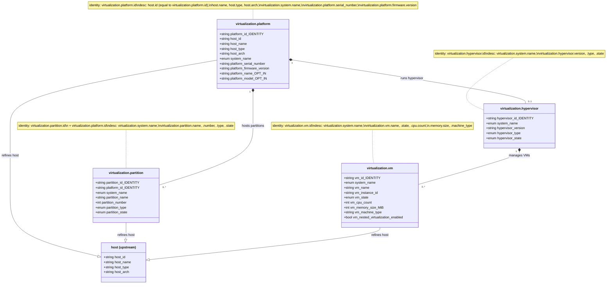

# Virtualization Semantic Conventions — Visual Semantic Models & Architecture

> **Scope:** This document illustrates the entity model, metric associations and cross-platform
> topology defined in `model/virtualization/` with Mermaid diagrams and a short architecture
> summary. Entity types, attribute keys and metric names are those of the `definition/2` YAML
> files. The generated registry pages under [docs/registry/virtualization/](registry/virtualization/README.md)
> are authoritative for the complete attribute and metric lists
> ([entities](registry/virtualization/entities.md), [metrics](registry/virtualization/metrics.md),
> [entity refinements](registry/virtualization/entity-refinements.md),
> [metric refinements](registry/virtualization/metric-refinements.md)); the diagrams below show
> selected attributes and metrics only.

---

## 1. Executive Summary

### Design Lessons & Trade-offs

The virtualization semantic conventions answer one architectural question: *How do we describe
the compute stack — from bare metal to VM — with a single entity model that works across IBM Z
PR/SM, IBM z/VM, VMware vSphere, KVM/libvirt and OpenShift Virtualization?*

Six lessons shaped the design:

**1. Minimal entity types, maximal attribute discrimination.**
Rather than creating a separate entity type per hypervisor platform, the model uses eight entity
types plus the `virtualization.system.name` enum to discriminate platforms. A single filter such
as `{virtualization_system_name="ibm.prsm"}` isolates all IBM Z PR/SM metrics.

**2. The `host` refinement pattern keeps upstream compatibility.**
`virtualization.platform`, `virtualization.partition` and `virtualization.vm` each refine the
upstream `host` entity (`refinement.virtualization.platform.host`,
`refinement.virtualization.partition.host`, `refinement.virtualization.vm.host`). Consumers that
understand only the generic host entity can therefore use their data, and the upstream `system.*`
metrics an operating system reports describe these entities. Metric refinements are added only
where a metric needs an additional attribute (for example `virtualization.partition.cpu.type` for
IBM Z processor types) or an explicit association with a virtualization entity (the `system.*`
refinements on `virtualization.vm` in `metrics_refinements_vm.yaml`).

**3. `virtualization.partition` fills the firmware-partitioning gap.**
IBM Z PR/SM logical partitions are enforced by firmware, not by a software hypervisor. They are
neither VMs (no hypervisor software) nor bare-metal hosts (they share physical hardware).
`virtualization.partition` models this concept; it coexists with `virtualization.vm` in mixed
environments where IBM z/VM runs inside an LPAR.

**4. Counter-based latency enables average derivation.**
`virtualization.vm.disk.latency.time` (unit `s`, instrument counter) accumulates the time spent in
disk I/O. Dividing `rate(latency_time)` by `rate(disk_operations)` yields the average latency per
operation in seconds — without histograms or high-frequency sampling.

**5. Dual lineage is an attribute, not an entity.**
OpenShift Virtualization VMIs have both a virtualization identity and a Kubernetes identity.
Rather than introducing a new entity type, the model carries the Kubernetes correlation in
`virtualization.vm.node.name` and, as an upstream attribute, `k8s.namespace.name`. The
`virtualization.vm` entity remains the primary anchor.

**6. Identity is stable and the same for every observer.**
Every entity is identified by an `*.id` attribute (the partition by `virtualization.partition.id`
together with `virtualization.platform.id`). The attribute definition states the uniqueness
scope and how each platform fills the value; names such as `host.name` or
`virtualization.cluster.name` are descriptive, because a rename must not end an entity's
lifespan. Identifiers of management-tool internal objects are not used, since other observers
cannot see them. A VM's identity never includes the host or hypervisor it runs on, so it
survives vMotion, KVM live migration and z/VM Live Guest Relocation.

---

## 2. Compute & Partitioning ERD

The first diagram shows the four entities involved in compute and workload isolation, including
their identity attributes, descriptive attributes and `host` refinement lineage.



**Notes:**

- `_IDENTITY` marks attributes in the entity `identity:` block — together they identify an
  instance. All other attributes are in the `description:` block; `_OPT_IN` marks attributes with
  requirement level `opt_in`.
- The `--|>` arrows indicate `entity_refinements:` (is-a, not inheritance in the OOP sense).
- `virtualization.platform.id` is the platform's stable key: on IBM Z the CPC's
  `<machine type>-<serial number>` with leading zeros removed from the serial (e.g. `3931-45A01`),
  on VMware vSphere the ESXi host hardware UUID, on KVM/libvirt the host machine ID. `host.id`
  SHOULD carry the same value, so consumers of the generic host entity identify the same platform;
  `host.name` is descriptive.
- `virtualization.partition` has a two-attribute identity because partition IDs are unique only
  within a platform. On IBM Z, `virtualization.partition.id` is the LPAR name.
- `virtualization.vm.memory.size` is an attribute in MiB; the memory metrics in §4 are in bytes.

---

## 3. Cluster & Resource Governance ERD

The second diagram shows the cluster and resource governance entities and their containment
relationships.

```mermaid
classDiagram
    class virt_cluster["virtualization.cluster"] {
        +string cluster_id_IDENTITY
        +string cluster_name
    }

    class virt_resource_pool["virtualization.resource_pool"] {
        +string pool_id_IDENTITY
        +string pool_name
        +enum system_name
    }

    class virt_platform["virtualization.platform"] {
        +string platform_id_IDENTITY
        +enum system_name
    }

    class virt_vm["virtualization.vm"] {
        +string vm_id_IDENTITY
        +int vm_cpu_count
        +int vm_memory_size_MiB
        +enum vm_state
    }

    class MetricClusterHostCount {
        <<metric>>
        +name cluster_host_count
        +instrument updowncounter
        +unit host
    }

    class MetricClusterVMCount {
        <<metric>>
        +name cluster_vm_count
        +instrument updowncounter
        +unit vm
    }

    class MetricPoolCPU {
        <<metric>>
        +name resource_pool_cpu_allocated
        +instrument gauge
        +unit cpu
    }

    class MetricPoolMemory {
        <<metric>>
        +name resource_pool_memory_allocated
        +instrument gauge
        +unit By
    }

    note for MetricClusterHostCount "virtualization.cluster.host.count\nattrs: virtualization.cluster.name, virtualization.cluster.id,\nvirtualization.system.name"
    note for MetricClusterVMCount "virtualization.cluster.vm.count\nattrs: virtualization.cluster.name, virtualization.cluster.id,\nvirtualization.vm.state, virtualization.system.name"
    note for MetricPoolCPU "virtualization.resource_pool.cpu.allocated\nattrs: virtualization.resource_pool.name,\nvirtualization.resource_pool.id, virtualization.system.name"
    note for MetricPoolMemory "virtualization.resource_pool.memory.allocated\nattrs: virtualization.resource_pool.name,\nvirtualization.resource_pool.id, virtualization.system.name"

    %% Containment
    virt_cluster "1" *-- "1..*" virt_platform : contains nodes
    virt_cluster "1" *-- "0..*" virt_resource_pool : governs pools
    virt_resource_pool "1" *-- "0..*" virt_vm : bounds VMs

    %% Metric associations
    virt_cluster       .. MetricClusterHostCount
    virt_cluster       .. MetricClusterVMCount
    virt_resource_pool .. MetricPoolCPU
    virt_resource_pool .. MetricPoolMemory
```



**Platform-specific notes:**

| Entity | IBM Z | VMware vSphere | KVM / oVirt | OpenShift Virtualization |
| --- | --- | --- | --- | --- |
| `virtualization.cluster` | z/VM SSI cluster; `virtualization.cluster.id` = SSI cluster name | ClusterComputeResource; id = vCenter instance UUID + cluster MoRef, e.g. `<vCenter UUID>/domain-c7` | oVirt or Proxmox VE cluster | OpenShift cluster |
| `virtualization.resource_pool` | PR/SM shared processor pool; id = CPC key + pool name, e.g. `3931-45A01/IFLPOOL` | ResourcePool; id = vCenter instance UUID + ResourcePool MoRef, e.g. `<vCenter UUID>/resgroup-21` | cgroup v2 slice | Namespace ResourceQuota |

The attribute definitions give identifier fill rules for IBM Z and VMware vSphere only; for the
KVM cluster managers and OpenShift Virtualization the columns show the corresponding native
construct.

---

## 4. Storage & Memory Architecture ERD

The third diagram shows the storage pool entity, its relationship to VMs, and the memory
signals including ballooning and swap.

```mermaid
classDiagram
    class virt_storage_pool["virtualization.storage_pool"] {
        +string pool_id_IDENTITY
        +string pool_name
        +enum system_name
    }

    class virt_vm["virtualization.vm"] {
        +string vm_id_IDENTITY
        +int vm_memory_size_MiB
    }

    class MetricStorageUsed {
        <<metric>>
        +name storage_pool_used
        +instrument updowncounter
        +unit By
    }

    class MetricStorageAvail {
        <<metric>>
        +name storage_pool_available
        +instrument updowncounter
        +unit By
    }

    class MetricDiskIO {
        <<metric>>
        +name vm_disk_io
        +instrument counter
        +unit By
        +dim disk_direction
    }

    class MetricDiskOps {
        <<metric>>
        +name vm_disk_operations
        +instrument counter
        +unit operation
        +dim disk_direction
    }

    class MetricDiskLatency {
        <<metric>>
        +name vm_disk_latency_time
        +instrument counter
        +unit s
        +dim disk_direction
    }

    class MetricDiskErrors {
        <<metric>>
        +name vm_disk_errors
        +instrument counter
        +unit error
        +dim disk_direction
    }

    class MetricMemAlloc {
        <<metric>>
        +name vm_memory_allocated
        +instrument gauge
        +unit By
    }

    class MetricMemUsed {
        <<metric>>
        +name vm_memory_used
        +instrument gauge
        +unit By
    }

    class MetricMemBalloon {
        <<metric>>
        +name vm_memory_balloon
        +instrument gauge
        +unit By
    }

    class MetricMemSwapped {
        <<metric>>
        +name vm_memory_swapped
        +instrument gauge
        +unit By
    }

    class MetricMemRSS {
        <<metric>>
        +name vm_memory_rss
        +instrument gauge
        +unit By
    }

    note for MetricStorageUsed "virtualization.storage_pool.used\nattrs: virtualization.storage_pool.name,\nvirtualization.storage_pool.id, virtualization.system.name"
    note for MetricStorageAvail "virtualization.storage_pool.available\nattrs: virtualization.storage_pool.name,\nvirtualization.storage_pool.id, virtualization.system.name"
    note for MetricDiskIO "virtualization.vm.disk.io\nattrs: virtualization.vm.id, virtualization.vm.disk.name\ndim: virtualization.vm.disk.direction = read or write"
    note for MetricDiskOps "virtualization.vm.disk.operations\nattrs: virtualization.vm.id, virtualization.vm.disk.name\ndim: virtualization.vm.disk.direction = read or write"
    note for MetricDiskLatency "virtualization.vm.disk.latency.time\navg latency = rate(latency.time) / rate(operations)\ndim: virtualization.vm.disk.direction = read or write"
    note for MetricDiskErrors "virtualization.vm.disk.errors\nattrs: virtualization.vm.id, virtualization.vm.disk.name\ndim: virtualization.vm.disk.direction (recommended)"
    note for MetricMemAlloc "virtualization.vm.memory.allocated\nmemory committed to the VM by the hypervisor"
    note for MetricMemUsed "virtualization.vm.memory.used\nmemory the guest actively uses (subset of allocated)"
    note for MetricMemBalloon "virtualization.vm.memory.balloon\nnon-zero = hypervisor reclaiming guest memory"
    note for MetricMemSwapped "virtualization.vm.memory.swapped\nbytes in hypervisor swap space"
    note for MetricMemRSS "virtualization.vm.memory.rss\nphysical host memory backing the VM (KVM, KubeVirt)\nattrs: virtualization.vm.id, virtualization.vm.node.name"

    %% Containment
    virt_storage_pool "1" *-- "0..*" virt_vm : backs virtual disks

    %% Storage pool metrics
    virt_storage_pool .. MetricStorageUsed
    virt_storage_pool .. MetricStorageAvail

    %% VM disk metrics
    virt_vm .. MetricDiskIO
    virt_vm .. MetricDiskOps
    virt_vm .. MetricDiskLatency
    virt_vm .. MetricDiskErrors

    %% VM memory metrics
    virt_vm .. MetricMemAlloc
    virt_vm .. MetricMemUsed
    virt_vm .. MetricMemBalloon
    virt_vm .. MetricMemSwapped
    virt_vm .. MetricMemRSS
```



**Memory signal semantics (all in bytes):**

```text
virtualization.vm.memory.allocated      = memory committed to the VM by the hypervisor
│
├── virtualization.vm.memory.used       = memory the guest actively uses, as estimated by the hypervisor
├── virtualization.vm.memory.balloon    = memory reclaimed by the balloon driver (host pressure)
├── virtualization.vm.memory.swapped    = memory swapped to hypervisor swap space
└── virtualization.vm.memory.rss        = physical host pages backing this VM (KVM and KubeVirt)
```

The guest operating system's own view of its memory is reported with the upstream
`system.memory.usage` and `system.memory.utilization` metrics, which
`refinement.virtualization.vm.system.memory.usage` and
`refinement.virtualization.vm.system.memory.utilization` associate with `virtualization.vm`.

---

## 5. Virtual Networking & Fabric ERD

The fourth diagram shows the virtual switch entity, its physical NIC uplinks, and VM and
partition network attachments.

```mermaid
classDiagram
    class virt_vswitch["virtualization.vswitch"] {
        +string vswitch_id_IDENTITY
        +string vswitch_name
        +enum system_name
    }

    class virt_vm["virtualization.vm"] {
        +string vm_id_IDENTITY
        +string vm_network_interface_name
    }

    class virt_partition["virtualization.partition"] {
        +string partition_id_IDENTITY
        +string platform_id_IDENTITY
    }

    class MetricNetIO {
        <<metric>>
        +name system_network_io
        +instrument counter
        +unit By
        +dim network_io_direction
    }

    class MetricNetDropped {
        <<metric>>
        +name system_network_packet_dropped
        +instrument counter
        +unit packet
        +dim network_io_direction
    }

    class MetricNetErrors {
        <<metric>>
        +name system_network_errors
        +instrument counter
        +unit error
        +dim network_io_direction
    }

    class MetricHWNetIO {
        <<metric>>
        +name hw_network_io
        +instrument counter
        +unit By
        +dim network_io_direction
    }

    class MetricHWNetBandwidth {
        <<metric>>
        +name hw_network_bandwidth_utilization
        +instrument gauge
        +unit ratio
    }

    class MetricVMNetIO {
        <<metric>>
        +name vm_network_io
        +instrument counter
        +unit By
        +dim network_io_direction
    }

    note for MetricNetIO "system.network.io (refined)\nrefinement.virtualization.system.network.io\nattrs: network.interface.name, network.io.direction,\nvirtualization.vswitch.name (opt-in)"
    note for MetricNetDropped "system.network.packet.dropped (refined)\nrefinement.virtualization.system.network.packet.dropped\nattrs: network.interface.name, network.io.direction,\nvirtualization.vswitch.name (opt-in)"
    note for MetricNetErrors "system.network.errors (refined)\nrefinement.virtualization.system.network.errors\nattrs: network.interface.name, network.io.direction,\nvirtualization.vswitch.name (opt-in)"
    note for MetricHWNetIO "hw.network.io (refined)\nrefinement.virtualization.hw.network.io\nattrs: virtualization.vswitch.name, hw.id, hw.name,\nnetwork.io.direction"
    note for MetricHWNetBandwidth "hw.network.bandwidth.utilization (refined)\nrefinement.virtualization.hw.network.bandwidth.utilization\nattrs: virtualization.vswitch.name, hw.id, hw.name"
    note for MetricVMNetIO "virtualization.vm.network.io\nattrs: virtualization.vm.id,\nvirtualization.vm.network.interface.name, network.io.direction"

    %% Connectivity
    virt_vswitch "1" *-- "0..*" virt_vm : carries traffic for VMs
    virt_vswitch "1" *-- "0..*" virt_partition : carries traffic for partitions

    %% vswitch hw metrics
    virt_vswitch .. MetricHWNetIO
    virt_vswitch .. MetricHWNetBandwidth

    %% VM network metrics
    virt_vm .. MetricNetIO
    virt_vm .. MetricNetDropped
    virt_vm .. MetricNetErrors
    virt_vm .. MetricVMNetIO

    %% Partition network metrics
    virt_partition .. MetricNetIO
    virt_partition .. MetricNetDropped
    virt_partition .. MetricNetErrors
```



**Notes:**

- The `system.network.*` refinements are also associated with `virtualization.vswitch`; the
  diagram shows only the VM and partition associations.
- The `hw.network.*` refinements (`io`, `packets`, `bandwidth.limit`, `bandwidth.utilization`,
  `up`) describe the physical uplink adapters of a virtual switch; `hw.id` identifies the adapter.
- `virtualization.vswitch.id` is unique across management domains. A distributed switch spans
  hosts, so its identifier does not include a host: on VMware vSphere it is the distributed
  switch UUID. Per-host switches are qualified by their host or hypervisor, for example the
  host hardware UUID and switch name for a standard vSwitch, or `3931-45A01/ZVM1/VSWITCH1` for an
  IBM z/VM VSWITCH.
